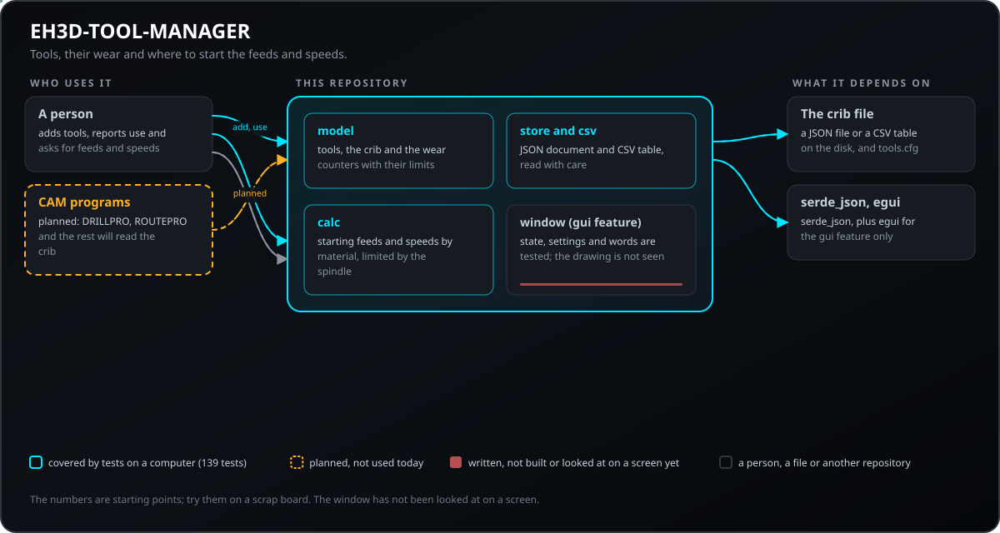
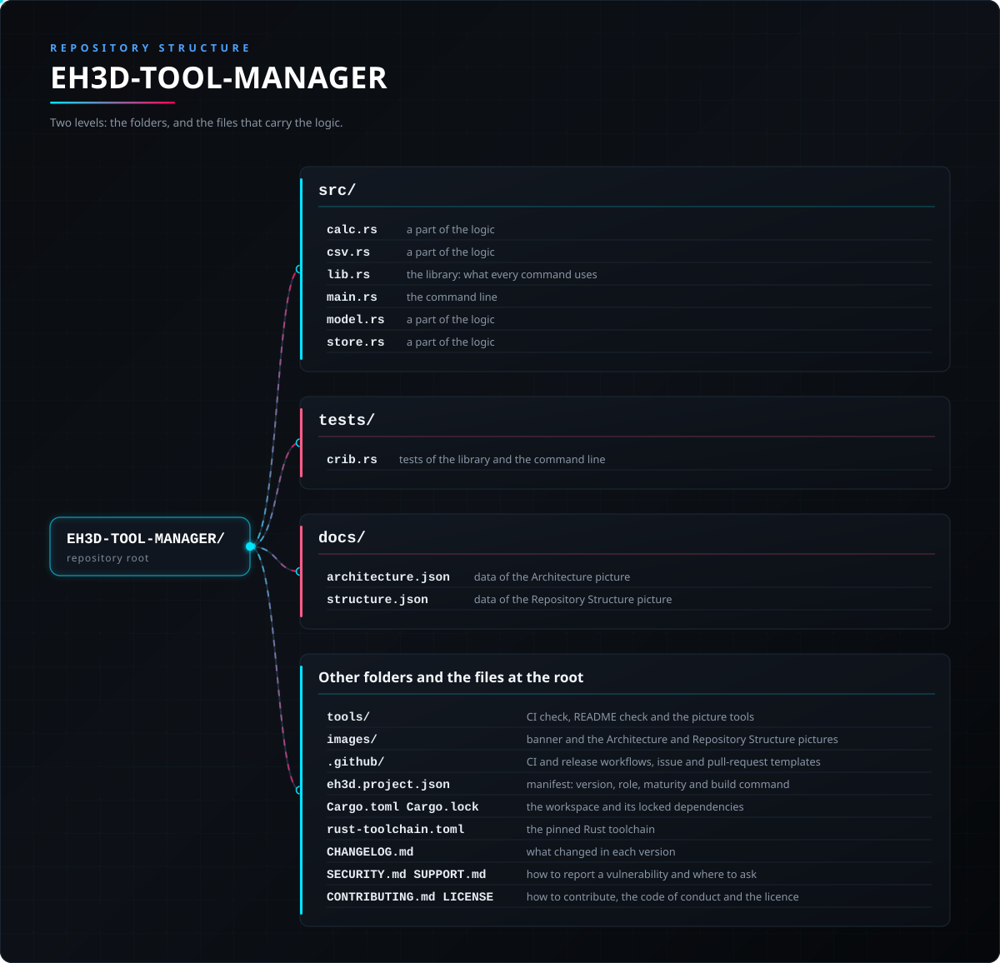

<p align="center">
  
</p>

#  EH3D-TOOL-MANAGER

<p align="center"><a href="README.md">🇺🇸 English</a> | 🇪🇸 <b>Español</b> | <a href="README_fra.md">🇫🇷 Français</a> | <a href="README_ita.md">🇮🇹 Italiano</a> | <a href="README_deu.md">🇩🇪 Deutsch</a> | <a href="README_zho.md">🇨🇳 中文</a> | <a href="README_jpn.md">🇯🇵 日本語</a> | <a href="README_por.md">🇵🇹 Português</a></p>

### El almacén de herramientas de la EH3D Fabrication Suite: herramientas, desgaste, avances y velocidades

<p align="center">
  
  
  
  
  
</p>

---

**Comprobación de honestidad - lo que funciona hoy:** una biblioteca Rust y un programa de línea de comandos (`eh3d-tools`) con 115 pruebas que se ejecutan en un ordenador: guarda las herramientas con su geometría y desgaste, las almacena en JSON o CSV y calcula avances y velocidades de partida por material. Una ventana (`eh3d-tools-gui`, compilada con la característica `gui`) está escrita y su lógica está probada, pero no se ha compilado ni mirado en una pantalla; nada se ha probado en una máquina y nada se ha comprobado con una colección de ficheros reales.

---

> **Estado de seguridad:** este programa no controla ninguna máquina y no es un sistema de seguridad. Lo que produce debe revisarlo una persona antes de ejecutar nada en una máquina; nada de esto se ha ejecutado en hardware real.


## 📋 De un vistazo

| | |
|---|---|
| Versión | `0.0.6` |
| Madurez | Andamiaje |
| Pruebas | 115 |
| Pila tecnológica | Rust |
| En hardware real | No probado: nada de esto se ha ejecutado en una máquina |

**Ir a:** [Resumen](#-resumen) · [Arquitectura](#-arquitectura) · [Inicio rápido](#-inicio-rápido) · [Pruebas](#-pruebas) · [Estructura](#-estructura-del-repositorio) · [Relacionados](#-proyectos-relacionados)

## 🚦 Estado del proyecto

Cada línea es una parte de este repositorio y la luz dice hasta dónde llega hoy. Se escribe con lo que el repositorio puede demostrar (pruebas, compilaciones, ejecuciones), no con lo previsto.

🟢 Hecho y verificado · 🟡 Funciona, con límites conocidos · 🟠 Hecho a medias o sin verificar · 🔴 Sin hacer o sin funcionar

| Área | Estado | Qué significa aquí |
|---|---|---|
| Núcleo | 🟡 | guarda las herramientas con su geometría y desgaste, las almacena en JSON o CSV y calcula avances y velocidades de partida por material; probado en un ordenador con entradas normales y dañadas, no con una colección de ficheros reales. |
| Línea de comandos | 🟡 | `eh3d-tools` ejecuta las mismas funciones que la biblioteca e imprime el resultado; cada error vuelve como mensaje y un código de salida distinto de cero. |
| Pruebas | 🟡 | 115 pruebas pasan (`cargo test`), con casos normales, casos límite y entradas dañadas. |
| Seguridad | 🟡 | Rust seguro y simple (`forbid(unsafe_code)`): nada entra en pánico con los ficheros recibidos y un valor malo es un error con su motivo; sin revisión independiente. |
| Ventana | 🟠 | Escrita (egui, `--features gui`, programa `eh3d-tools-gui`): una tabla de herramientas que se añaden, cambian y quitan con las comprobaciones de la línea de comandos, filtros y búsqueda, importación y exportación de CSV con los errores de la biblioteca y una calculadora de avances y velocidades que muestra sus fórmulas y condiciones; su lógica está probada, pero aún no se ha compilado ni mirado en una pantalla. |
| Hardware real | 🔴 | No probado: nada de esto se ha ejecutado en una máquina. |
| Documentación | 🟡 | README en ocho idiomas, el registro de cambios y las dos imágenes dibujadas desde `docs/`. |

## 🎯 Resumen

* **El almacén** (`src/model.rs`): brocas, fresas, fresas en V, grabadoras, láseres y boquillas con diámetro, labios, longitud, ángulo de punta y mango; cada valor se comprueba y un nombre repetido se rechaza; cada herramienta recibe su número. Un contador de desgaste o un número de filos que no sea entero se rechaza con el nombre del campo, en los archivos y en la línea de órdenes.
* **El desgaste** (`src/model.rs`): horas, metros y agujeros se suman tras cada trabajo; con un límite de horas o agujeros, una herramienta está bien, para cambiar pronto (desde el 90 %) o para cambiar, y `wear` lista las peores primero.
* **Almacenamiento y avances y velocidades** (`src/store.rs`, `src/csv.rs`, `src/calc.rs`): el almacén como documento JSON o tabla CSV para una hoja de cálculo, leído con cuidado y con la fila indicada en cada error; velocidad de corte y avance por diente para FR4, aluminio, acrílico, madera y latón, limitados por el husillo.
* **La ventana** (`src/window.rs`, `src/gui.rs`; `--features gui`, programa `eh3d-tools-gui`): una tabla de herramientas con un formulario para añadirlas, cambiarlas y quitarlas con las mismas comprobaciones que la línea de comandos (el número de una herramienta quitada no se vuelve a dar), filtros y búsqueda, el uso de una herramienta sumado a sus contadores, importación y exportación de CSV con los errores de la biblioteca y una calculadora que muestra la fórmula y las condiciones de cada número; los números con los que trabaja (velocidades de corte, avances por diente, factores) están en `tools.cfg` y se pueden cambiar en la ventana. El estado, las acciones, los ajustes y las palabras son código simple con pruebas; el dibujo es fino. Escrita, aún no vista en una pantalla.

## 🧩 Papel en EH3D

EH3D-TOOL-MANAGER es un programa de la EH3D Fabrication Suite. Funciona como biblioteca, como línea de comandos y, compilado con la característica `gui`, como ventana (`eh3d-tools-gui`) con el aspecto que comparten los demás programas de la suite. Lee y escribe ficheros simples, así que puede usarse solo o entre los demás programas.

## 🏛️ Arquitectura

<p align="center">
  
</p>


Cómo encajan las partes de este repositorio: quién lo usa, qué contiene y de qué depende. La imagen se dibuja desde `docs/architecture.json` y se comprueba con el código.

## ✨ Funciones

* **Biblioteca y línea de comandos:** cada orden de `eh3d-tools` es una función de la biblioteca, así que otro programa de la suite puede llamarla sin lanzar un proceso.
* **Pruebas con entradas dañadas:** las pruebas también dan ficheros vacíos, basura, números enormes y ficheros cortados, y ninguna puede provocar un pánico.
* **Sin adivinar:** un valor que no tiene sentido es un error que dice cuál y por qué, nunca un resultado que solo lo parece.
* **Sin código unsafe:** `#![forbid(unsafe_code)]` en la biblioteca y el programa.
* **Un almacén que aguanta:** el número de una herramienta retirada no se vuelve a dar (el almacén guarda `next_id`), un id que no es un número entero se dice así, el CSV rechaza texto tras unas comillas de cierre, un texto que empieza como una fórmula (`=`, `+`, `-`, `@`) se escribe como texto para que la hoja de cálculo no lo ejecute, el material tiene un límite, `--holes` es un número entero, una opción desconocida es un error y `calc` dice que el resultado de una fresa en V o de un grabador es solo un punto de partida.

## 🔒 Seguridad y protección

| Amenaza | Defensa |
|---|---|
| Un fichero dañado, cortado o vacío | sin pánico: las pruebas cortan una entrada válida en cada posición y dan basura |
| Un número sin sentido (negativo, no finito, absurdamente grande) | se rechaza con un error que nombra el valor; nada se redondea hasta parecer plausible |
| Uso inseguro de memoria | Rust seguro y simple con `forbid(unsafe_code)` |

**Lo que no se defiende:** un resultado producido sin errores no es un resultado verificado. Nada de esto conoce los límites de una máquina y el programa no ha tenido revisión independiente. Informe de una vulnerabilidad en privado (véase [SECURITY.md](SECURITY.md)).

## 🔌 Interfaces

La biblioteca es `eh3d_tool_manager` (`use eh3d_tool_manager::...`); la línea de comandos es `eh3d-tools`. Las órdenes son estas; cada una imprime su resultado por la salida estándar e informa de un error por la salida de errores con un código de salida distinto de cero. No hay acceso a la red.

```text
EH3D-TOOL-MANAGER/
├── src/
│   ├── calc.rs                                  una parte de la lógica
│   ├── cli_args.rs                              los argumentos de la línea de órdenes, leídos con rigor
│   ├── csv.rs                                   una parte de la lógica
│   ├── gui.rs                                   la ventana (egui, con la característica gui): dibuja el estado y transmite lo que hace la persona
│   ├── gui_main.rs                              la ventana como programa propio, sin consola en Windows
│   ├── lang.rs                                  las palabras de la ventana en los ocho idiomas
│   ├── lib.rs                                   la biblioteca: lo que usa cada orden
│   ├── main.rs                                  la línea de comandos
│   ├── model.rs                                 una parte de la lógica
│   ├── settings.rs                              los ajustes de tools.cfg: idioma, tamaño de la ventana, fichero del almacén y los números del cálculo
│   ├── store.rs                                 una parte de la lógica
│   └── window.rs                                el estado de la ventana sin pantalla: el almacén, el formulario, los filtros y la calculadora
├── tests/
│   └── crib.rs                                  pruebas de la biblioteca y la línea de comandos
├── docs/
│   ├── architecture.json                        datos de la imagen de Arquitectura
│   └── structure.json                           datos de la imagen de Estructura
├── tools/                                       comprobación del CI y del README y herramientas de imágenes
├── images/                                      banner y las imágenes de Arquitectura y Estructura del repositorio
├── .github/                                     flujos de CI y de publicación, plantillas de issues y pull requests
├── eh3d.project.json                            manifiesto: versión, rol, madurez y comando de compilación
├── Cargo.toml Cargo.lock                        el workspace y sus dependencias fijadas
├── rust-toolchain.toml                          la toolchain de Rust fijada
├── CHANGELOG.md                                 qué cambió en cada versión
├── SECURITY.md SUPPORT.md                       cómo informar de una vulnerabilidad y dónde preguntar
├── CONTRIBUTING.md CODE_OF_CONDUCT.md LICENSE   cómo contribuir, el código de conducta y la licencia
└── tools.cfg.example                            todos los ajustes de tools.cfg con su valor por defecto
```

## ⚙️ Configuración

El fichero de configuración es `tools.cfg` en la carpeta del programa (la variable `EH3D_TOOLS_DIR`, o `%APPDATA%\eh3d-tools` en Windows, o `~/.config/eh3d-tools` en otros sistemas), leído por la ventana y por la orden `calc`: el idioma y el tamaño de la ventana, el fichero del almacén, la velocidad del husillo con la que arranca la calculadora y cada número con el que se calculan los avances y velocidades (la velocidad de corte y el avance por diente de cada material y los factores de la penetración y de la profundidad de pasada) son líneas `clave = valor`, con sus límites comprobados y una línea mala nombrada en el error. `tools.cfg.example` enumera cada clave con su valor por defecto. Aparte de eso, lo que elige la persona se da como argumentos de la línea de comandos (véase Interfaces) y cada valor por defecto está escrito en la ayuda de la orden (`eh3d-tools help`). Los límites de un valor son constantes con nombre del código y las pruebas los cubren.

## 🚀 Inicio rápido

Necesita una cadena de herramientas Rust estable (1.95 o más reciente).

```bash
cargo build --release
cargo test
cargo run --release -- calc drill 0.8 fr4 24000
# la ventana (necesita la característica gui)
cargo build --release --features gui
cargo run --release --features gui --bin eh3d-tools-gui
```

## 🧪 Pruebas

El conjunto tiene 115 pruebas (`cargo test`, ejecutadas en Windows y Linux en el CI). Comprueban los casos normales, los casos límite y las entradas dañadas: ficheros vacíos, basura y ficheros cortados nunca provocan un pánico. El CI ejecuta además `cargo fmt --check`, `cargo clippy` (también con `--features gui`) con las advertencias como errores y `python -I tools/ci_validate.py`.

## 🏗️ Compilación y publicación

La versión está en `Cargo.toml` y en `eh3d.project.json`; cada versión tiene su entrada en [CHANGELOG.md](CHANGELOG.md). `build.bat` / `build.sh` compilan el programa, `test.bat` / `test.sh` ejecutan las pruebas y `run.bat` / `run.sh` lo ejecutan con un ejemplo. Las versiones se publican en GitHub.

### Descargas

Cada versión trae el programa de línea de comandos y la ventana para Windows (64 y 32 bits), Linux (64 bits) y macOS (Apple silicon e Intel), como `<nombre>-<versión>-<sistema>.zip` (Windows) o `.tar.gz` con los dos programas, la licencia, el readme, el icono y `tools.cfg.example`. Los ficheros los compila GitHub Actions y están en `SHA256SUMS`. Para comprobar una descarga, compare su hash con el fichero `.sha256` que la acompaña (`sha256sum -c`).

## 📂 Estructura del repositorio

<p align="center">
  
</p>

<details>
<summary>Versión en texto del árbol</summary>

```text
EH3D-TOOL-MANAGER/
├── src/
│   ├── calc.rs                                  una parte de la lógica
│   ├── cli_args.rs                              los argumentos de la línea de órdenes, leídos con rigor
│   ├── csv.rs                                   una parte de la lógica
│   ├── gui.rs                                   la ventana (egui, con la característica gui): dibuja el estado y transmite lo que hace la persona
│   ├── gui_main.rs                              la ventana como programa propio, sin consola en Windows
│   ├── lang.rs                                  las palabras de la ventana en los ocho idiomas
│   ├── lib.rs                                   la biblioteca: lo que usa cada orden
│   ├── main.rs                                  la línea de comandos
│   ├── model.rs                                 una parte de la lógica
│   ├── settings.rs                              los ajustes de tools.cfg: idioma, tamaño de la ventana, fichero del almacén y los números del cálculo
│   ├── store.rs                                 una parte de la lógica
│   └── window.rs                                el estado de la ventana sin pantalla: el almacén, el formulario, los filtros y la calculadora
├── tests/
│   └── crib.rs                                  pruebas de la biblioteca y la línea de comandos
├── docs/
│   ├── architecture.json                        datos de la imagen de Arquitectura
│   └── structure.json                           datos de la imagen de Estructura
├── tools/                                       comprobación del CI y del README y herramientas de imágenes
├── images/                                      banner y las imágenes de Arquitectura y Estructura del repositorio
├── .github/                                     flujos de CI y de publicación, plantillas de issues y pull requests
├── eh3d.project.json                            manifiesto: versión, rol, madurez y comando de compilación
├── Cargo.toml Cargo.lock                        el workspace y sus dependencias fijadas
├── rust-toolchain.toml                          la toolchain de Rust fijada
├── CHANGELOG.md                                 qué cambió en cada versión
├── SECURITY.md SUPPORT.md                       cómo informar de una vulnerabilidad y dónde preguntar
├── CONTRIBUTING.md CODE_OF_CONDUCT.md LICENSE   cómo contribuir, el código de conducta y la licencia
└── tools.cfg.example                            todos los ajustes de tools.cfg con su valor por defecto
```

</details>

## 🗺️ Hoja de ruta y límites conocidos

**Límites conocidos hoy**

* La ventana está escrita y su lógica está probada, pero aún no se ha compilado ni mirado en una pantalla.
* La ventana pide el fichero del almacén y la tabla CSV como rutas escritas (aún no hay diálogo de ficheros).
* No se ha probado en una máquina ni con una colección de ficheros reales y no ha tenido revisión independiente.
* El almacén es un fichero JSON, no una base de datos; los avances y velocidades son puntos de partida de valores típicos y no se han comprobado en una máquina; los programas de la suite todavía no leen el almacén.

**Siguiente**

* Que DRILLPRO, ROUTEPRO y los programas CAM lean el almacén en vez de sus tablas propias, y añadir el perfil 2D de cada herramienta.
* Mirar la ventana en una pantalla de cada sistema y ajustar lo que se encuentre.
* Probarlo con ficheros reales y con los demás programas de la suite.

## 🌍 Idiomas

El README y los textos existen en inglés, español, francés, italiano, alemán, chino, japonés y portugués de Portugal.

## 🔗 Proyectos relacionados

* [EH3D-COMMON](https://github.com/JuanenRac/EH3D-COMMON): el contenedor de proyecto y los tipos compartidos de la suite
* [EH3D-DRILLPRO](https://github.com/JuanenRac/EH3D-DRILLPRO): el programa de taladrado
* [EH3D-ROUTEPRO](https://github.com/JuanenRac/EH3D-ROUTEPRO): el programa de fresado de contorno
* [EH3D-ISOCAM](https://github.com/JuanenRac/EH3D-ISOCAM): el fresado de aislamiento del cobre
* [EH3D-PHOENIX-LASER](https://github.com/JuanenRac/EH3D-PHOENIX-LASER): el grabado y corte por láser
* [EH3D-PHOENIX-PNP](https://github.com/JuanenRac/EH3D-PHOENIX-PNP): el montaje pick and place
* [EH3D-SUITE-LAUNCHER](https://github.com/JuanenRac/EH3D-SUITE-LAUNCHER): el centro que encuentra y arranca los programas de la suite

## 📚 Documentación

* [Registro de cambios](CHANGELOG.md)
* [Datos de arquitectura y estructura](docs/architecture.json): los datos con los que se dibujan las dos imágenes.

## 🤝 Contribuir y comunidad

* Antes de una pull request ejecute `cargo fmt --check`, `cargo clippy --all-targets -- -D warnings`, `cargo test` y `python -I tools/ci_validate.py`: todo debe pasar. Véanse [CONTRIBUTING.md](CONTRIBUTING.md) y el [código de conducta](CODE_OF_CONDUCT.md).
* El README existe en ocho idiomas: un cambio de texto se hace en los ocho ficheros, y las dos imágenes se dibujan desde `docs/architecture.json` y `docs/structure.json` con `tools/make_architecture.py` y `tools/make_structure.py`.
* Informe de una vulnerabilidad en privado: [SECURITY.md](SECURITY.md). Preguntas, ideas e informes: electrohobby3d@gmail.com ([SUPPORT.md](SUPPORT.md)).

## 👤 AUTOR

**JuanenRac (Electro Hobby 3D)** · electrohobby3d@gmail.com

## 📜 LICENCIA

Software: GPL-3.0-or-later. Véase [LICENSE](LICENSE). Los diseños de hardware de la suite usan CERN OHL-S.
