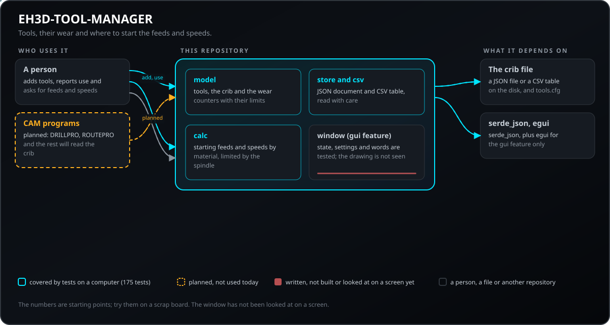
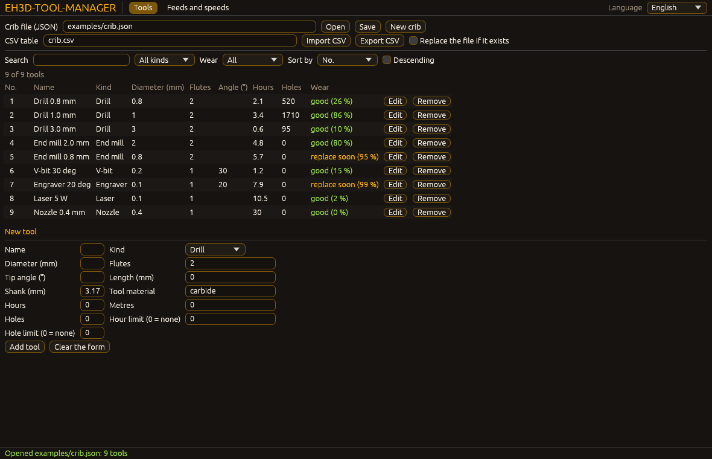
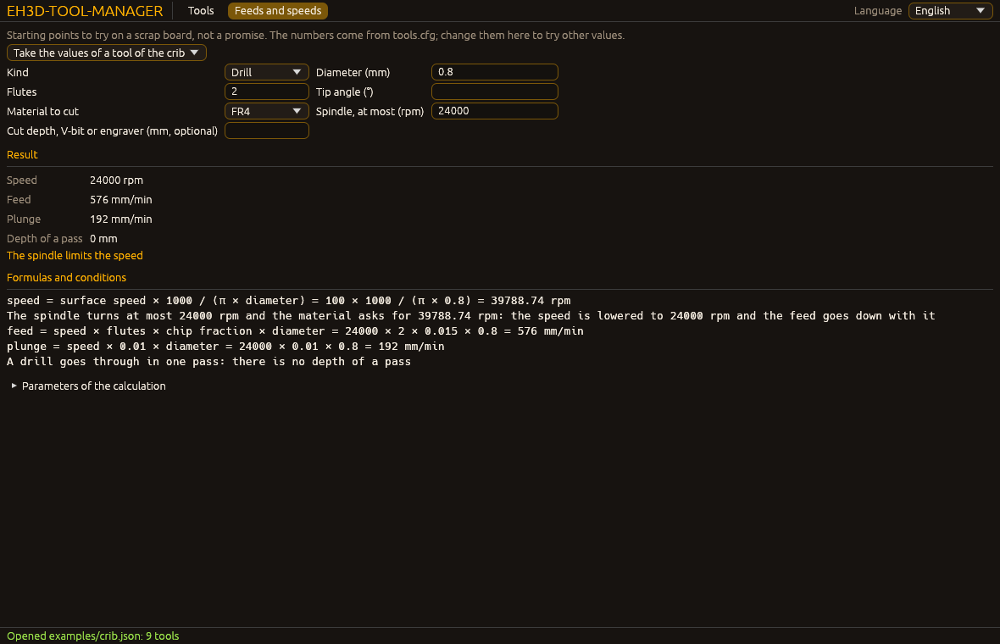
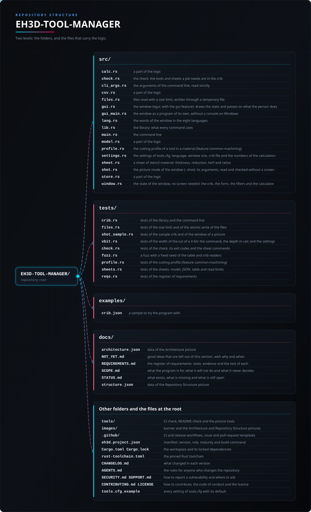

<p align="center">
  
</p>

#  EH3D-TOOL-MANAGER

<p align="center"><a href="README.md">🇺🇸 English</a> | <a href="README_spa.md">🇪🇸 Español</a> | <a href="README_fra.md">🇫🇷 Français</a> | <a href="README_ita.md">🇮🇹 Italiano</a> | <a href="README_deu.md">🇩🇪 Deutsch</a> | 🇨🇳 <b>中文</b> | <a href="README_jpn.md">🇯🇵 日本語</a> | <a href="README_por.md">🇵🇹 Português</a></p>

### EH3D Fabrication Suite 的刀具库：刀具、磨损、进给与转速

<p align="center">
  
  
  
  
  
</p>

---

**诚实检查 - 当前真正能运行的内容：** 一个 Rust 库和一个命令行程序（`eh3d-tools`），有 275 个在电脑上运行的测试：管理刀具的几何尺寸和磨损，以 JSON 或 CSV 存储，并按材料计算起始进给和转速。窗口（`eh3d-tools-gui`，用 `gui` 特性构建）已编写，其逻辑已测试，但尚未构建，也没有在屏幕上看过；没有在机器上试过任何东西，也没有用大量真实文件验证过。

---

> **安全状态：** 本程序不控制任何机器，也不是安全系统。它的输出在机器上运行之前必须由人检查；这里的任何内容都没有在真实硬件上运行过。


## 📋 速览

| | |
|---|---|
| 版本 | `0.1.2` |
| 成熟度 | 脚手架 |
| 测试 | 275 |
| 技术栈 | Rust |
| 真实硬件 | 未试过：这里的任何内容都没有在机器上运行过 |

**跳转到：** [概述](#-概述) · [架构](#-架构) · [快速开始](#-快速开始) · [测试](#-测试) · [结构](#-仓库结构) · [相关项目](#-相关项目)

## 🚦 项目状态

每一行是本仓库的一个部分，灯号表示它今天做到了哪一步。内容依据仓库能够展示的证据（测试、构建、运行），而不是计划。

🟢 已完成并验证 · 🟡 可用，有已知限制 · 🟠 部分完成或尚未验证 · 🔴 未完成或不可用

| 领域 | 状态 | 在这里的含义 |
|---|---|---|
| 核心 | 🟡 | 管理刀具的几何尺寸和磨损，以 JSON 或 CSV 存储，并按材料计算起始进给和转速；已在电脑上用正常和损坏的输入测试，未用大量真实文件验证。 |
| 命令行 | 🟡 | `eh3d-tools` 运行与库相同的函数并打印结果；每个错误都以消息和非零退出码返回。 |
| 测试 | 🟡 | 275 个测试通过（`cargo test`），包含正常情况、边界情况和损坏的输入，以及模拟的作业班次（非数字的报告、已不存在的刀具、失败的保存、中途被截断的刀库文件）及其恢复。 |
| 安全 | 🟡 | 纯安全 Rust（`forbid(unsafe_code)`）：处理收到的文件时不会 panic，错误的值会返回带原因的错误；没有独立审查。 |
| 窗口 | 🟠 | 已编写（egui，`--features gui`，程序 `eh3d-tools-gui`）：一个可用与命令行相同的检查添加、修改和移除刀具的表格、筛选和搜索、带库错误信息的 CSV 导入导出，以及显示公式和条件的进给与转速计算器；其逻辑已测试，但尚未构建，也没有在屏幕上看过。 |
| 真实硬件 | 🔴 | 未试过：这里的任何内容都没有在机器上运行过。 |
| 文档 | 🟡 | 八种语言的 README、更新日志，以及由 `docs/` 绘制的两张图。 |

## 🎯 概述

* **刀具库**（`src/model.rs`）：钻头、立铣刀、V 形刀、雕刻刀、激光和吸嘴，含直径、刃数、长度、刀尖角和刀柄；每个值都会检查，重名会被拒绝，每把刀具有自己的编号。磨损计数或刃数如果不是整数，会连同字段名一起被拒绝，文件和命令行均如此。
* **磨损**（`src/model.rs`）：每次作业后累加小时、米数和孔数；设置小时或孔数上限后，刀具分为良好、即将更换（达到 90 %）和需更换，`wear` 按最差优先列出。
* **存储与进给转速**（`src/store.rs`、`src/csv.rs`、`src/calc.rs`）：刀具库可存为 JSON 文档或供电子表格使用的 CSV 表，读取时每个错误都指出行号；按 FR4、铝、亚克力、木材和黄铜计算切削速度和每齿进给，并受主轴限制。
* **窗口**（`src/window.rs`、`src/gui.rs`；`--features gui`，程序 `eh3d-tools-gui`）：刀具表，以及用与命令行相同的检查添加、修改和移除刀具的表单（已移除刀具的编号不会再次分配）、筛选和搜索、把刀具的使用量累加到计数器、带库错误信息的 CSV 导入导出，以及显示每个数值的公式和条件的计算器；计算所用的数值（切削速度、每齿进给、系数）在 `tools.cfg` 中，也可在窗口中修改。状态、操作、设置和文字都是有测试的普通代码；绘制层很薄。已编写，尚未在屏幕上看过。

## 🧩 在 EH3D 中的角色

EH3D-TOOL-MANAGER 是 EH3D Fabrication Suite 的一个程序。它以库、命令行的形式工作，用 `gui` 特性构建后还是与套件其他程序外观一致的窗口（`eh3d-tools-gui`）。它读写简单的文件，因此可以单独使用，也可以用在其他程序之间。

## 🏛️ 架构

<p align="center">
  
</p>


本仓库各部分如何配合：谁使用它、它包含什么、它依赖什么。图由 `docs/architecture.json` 绘制并与代码核对。

## 🖼️ 屏幕截图

<p align="center">
  
</p>

<p align="center"><em>载入示例刀库的“工具”标签页：九把工具及其类型、尺寸、工时、孔数和磨损，以及添加新工具的表单。</em></p>

<p align="center">
  
</p>

<p align="center"><em>用 `--tab calc` 打开的“进给与转速”标签页：FR4 板上 0.8 mm 钻头的转速、进给、下刀和每刀深度，附每个数字的公式，并注明主轴限制了转速。</em></p>

## ✨ 功能

* **库加命令行：** `eh3d-tools` 的每个命令都是库中的函数，套件中的其他程序无需启动进程即可调用。
* **损坏输入的测试：** 测试还会输入空文件、乱码、巨大数字和被截断的文件，任何情况都不允许 panic。
* **不猜测：** 没有意义的值是一个说明哪个值、为什么的错误，绝不是只是看起来正确的结果。
* **文件大小上限与原子写入：** 刀具库和 CSV 表在命令行和窗口中，仅当不超过 `tools.cfg` 中的 `max_file_mib`（默认 16 MiB，范围 1 到 1024）时才会读取；更大的文件以代码 `file_too_large` 和文件名拒绝，无法读取的以 `file_unreadable` 拒绝，不是文本的以 `file_not_text` 拒绝，且不加载任何内容。刀具库和 CSV 表先写入真实文件旁的临时文件再改名覆盖，因此中断或磁盘已满时旧文件保持完整（失败时返回 `file_unwritable` 并删除临时文件）；CSV 导出仍然不会在没有本人指示时替换文件。
* **没有 unsafe 代码：** 库和程序中都有 `#![forbid(unsafe_code)]`。
* **更可靠的刀具库：** 已移除刀具的编号不会再次分配（刀具库保存 `next_id`），不是整数的 id 会如实说明，CSV 拒绝闭合引号之后的文字，以公式形式开头的文字（`=`、`+`、`-`、`@`）按文本写出以免电子表格执行，材料有长度上限，`--holes` 必须是整数，未知选项会报错，`calc` 会说明 V 形刀或雕刻刀的结果只是起点。
* **V 形刀的切削宽度：** `eh3d-tools vbit --depth MM [--angle 度] [--flat MM]` 计算 `2 x 深度 x tan(角度 / 2) + 平头宽度`（60 度的刀在 0.5 mm 深度下得到 0.5774 mm，再加上 0.1 mm 的平头 = 0.6774 mm）；角度为 10 到 170 度，深度为 0 到 100 mm，平头为 0 到 5 mm，未给出的值取自 `tools.cfg`。`calc --depth MM` 把这个宽度作为 V 形刀或雕刻刀在进给与转速计算中使用的直径，窗口的计算器有深度输入栏，显示切削宽度以及带数值的公式；没有深度时数值与以往相同。
* **恢复上一份备份：** `eh3d-tools restore FILE.json` 在确认备份可读之后，用 `FILE.json.bak`（上一次保存留下的备份）替换该文件，被替换的文件保留为 `FILE.json.damaged`，并警告在该备份之后保存的内容不在其中；窗口里有同样功能的“恢复备份”按钮。绝不会自动恢复。
* **列表、单个刀具的完整信息、更换、移除和汇总：** `eh3d-tools list FILE.json [--kind 类型] [--worn] [--sort id|name|wear]` 只显示某一类型或只显示已磨损的刀具，可按编号、按名称或按磨损程度从高到低排序（没有匹配时显示 `no tool matches`）；`show FILE.json ID` 打印刀具的全部数值以及距各上限还剩多少；`replace FILE.json ID` 用新刀具替换已磨损的刀具（计数器归零，其余保持不变，之前的文件保存为 `.bak`）；`remove FILE.json ID` 取出一把刀具（其编号不会再次分配）；`stats FILE.json` 按类型汇总刀具数、小时、米数、孔数和需更换的刀具数。每一项都是库中的函数（`Crib::select`、`Tool::remaining`、`Crib::replace_tool`、`Crib::summary`）。
* **模板薄板、刀库检查和切削档案：** `add-sheet FILE.json NAME MATERIAL THICKNESS_MM [--reduction MM] [--kerf MM] [--min-aspect R] [--min-area R]` 在刀具旁保存一块薄板（材料、厚度、每个开孔每侧缩小多少、光束的切缝，以及开孔的最小长宽比和最小面积比，0 表示不限）；`list-sheets`、`remove-sheet`、`export-sheets-csv` 和 `import-sheets-csv` 用于管理。刀具表保持原有的列且不含薄板，因此读取它的程序照旧读取；薄板有自己的表，其 `kind` 始终是 `sheet`，含薄板的刀库以格式 2 写出，只认识格式 1 的程序会拒绝它，而不是丢掉薄板。`check FILE.json [--needs TABLE.csv]` 检查作业所需的每把刀具（按名称和直径）和每块薄板（按名称和厚度）（以列为 `name,kind,size_mm` 的表写出）是否在刀库中，以及刀库自身是否一致；未通过时以退出码 2 结束（1 仍表示错误）。`tools.cfg` 的 `max_csv_rows` 和 `check_tolerance_mm` 限定表格和尺寸，错误的行以行号指出。`profile FILE.json ID MATERIAL_ID` 在使用 `--features common-machining` 构建时，从 EH3D-COMMON 的加工数据库读取某材料中刀具的起点，并首先说明这些数值未在机器上试过。

## 🔒 安全与防护

| 威胁 | 防御 |
|---|---|
| 损坏、被截断或为空的文件 | 不会 panic：测试在每个位置截断有效输入并输入乱码 |
| 没有意义的数字（负数、非有限值、过大的数） | 以指出该值的错误拒绝；不会被舍入成看似合理的值 |
| 不安全的内存使用 | 带 `forbid(unsafe_code)` 的纯安全 Rust |

**没有防御的内容：** 无错误产生的结果不等于经过验证的结果。这里没有任何内容了解机器的极限，程序也没有经过独立审查。请私下报告漏洞（见 [SECURITY.md](SECURITY.md)）。

## 🔌 接口

库为 `eh3d_tool_manager`（`use eh3d_tool_manager::...`），命令行为 `eh3d-tools`。命令如下；每个命令把结果打印到标准输出，把错误以非零退出码报告到标准错误。没有网络访问。

```text
EH3D-TOOL-MANAGER/
├── src/
│   ├── calc.rs                                  逻辑的一部分
│   ├── check.rs                                 检查：作业所需的刀具和薄板是否在刀库中
│   ├── cli_args.rs                              命令行参数（严格解析）
│   ├── csv.rs                                   逻辑的一部分
│   ├── files.rs                                 带大小上限的读取和经临时文件的写入
│   ├── gui.rs                                   窗口（egui，gui 特性）：绘制状态并传递用户的操作
│   ├── gui_main.rs                              作为独立程序的窗口，在 Windows 上没有控制台
│   ├── lang.rs                                  窗口的文字（八种语言）
│   ├── lib.rs                                   库：每个命令所使用的部分
│   ├── main.rs                                  命令行
│   ├── model.rs                                 逻辑的一部分
│   ├── profile.rs                               刀具在某材料中的切削档案（common-machining 特性）
│   ├── settings.rs                              tools.cfg 的设置：语言、窗口大小、刀具库文件和计算所用的数值
│   ├── sheet.rs                                 模板薄板：厚度、缩小量、切缝和比值
│   ├── shot.rs                                  窗口的截图模式（--shot）：无需屏幕即可读取和检查其参数
│   ├── store.rs                                 逻辑的一部分
│   └── window.rs                                无需屏幕的窗口状态：刀具库、表单、筛选和计算器
├── tests/
│   ├── crib.rs                                  库和命令行的测试
│   ├── files.rs                                 文件大小上限和原子写入的测试
│   ├── shot_sample.rs                           示例刀具库和截图窗口的测试
│   ├── vbit.rs                                  V 形刀切削宽度的测试：命令、calc 中的深度和设置
│   ├── check.rs                                 检查、其退出码和薄板命令的测试
│   ├── fuzz.rs                                  对表格和刀库读取器的固定种子模糊测试
│   ├── profile.rs                               切削档案的测试（common-machining 特性）
│   ├── sheets.rs                                薄板的测试：模型、JSON、表格和读取上限
│   └── reqs.rs                                  需求登记表的测试
├── examples/
│   └── crib.json                                试用的示例
├── docs/
│   ├── architecture.json                        架构图数据
│   ├── NOT_YET.md                               本版本暂不包含的好想法及其原因和时机
│   ├── REQUIREMENTS.md                          需求登记表：每项的状态、证据和测试
│   ├── SCOPE.md                                 用途、不做什么以及永远不由它决定的事
│   ├── STATUS.md                                已有的、缺少的和仍未决定的
│   └── structure.json                           结构图数据
├── tools/                                       CI 和 README 检查及绘图工具
├── images/                                      横幅图以及架构和仓库结构图片
├── .github/                                     CI 与发布工作流、Issue 和 PR 模板
├── eh3d.project.json                            清单：版本、角色、成熟度和构建命令
├── Cargo.toml Cargo.lock                        工作区及其锁定的依赖
├── rust-toolchain.toml                          固定的 Rust 工具链
├── CHANGELOG.md                                 每个版本的变更
├── AGENTS.md                                    修改本仓库的人需要遵守的规则
├── SECURITY.md SUPPORT.md                       如何报告漏洞及在哪里提问
├── CONTRIBUTING.md CODE_OF_CONDUCT.md LICENSE   参与贡献、行为准则和许可证
└── tools.cfg.example                            tools.cfg 的所有设置及其默认值
```

## ⚙️ 配置

配置文件是程序文件夹中的 `tools.cfg`（环境变量 `EH3D_TOOLS_DIR`，Windows 上为 `%APPDATA%\eh3d-tools`，其他系统为 `~/.config/eh3d-tools`），由窗口和 `calc` 命令读取：窗口的语言和大小、刀具库文件、计算器启动时使用的主轴转速，以及计算进给与转速所用的每个数值（每种材料的切削速度和每齿进给，下刀和单次切深的系数，以及计算 V 形刀所用的角度 `v_bit_angle_deg`（10 到 170 度，默认 60）和平头刀尖宽度 `v_bit_flat_mm`（0 到 5 mm，默认 0.1））都是 `键 = 值` 的行，其限制会被检查，错误行会在错误信息中指出。`tools.cfg.example` 列出了每个键及其默认值。除此之外，用户的选择通过命令行参数给出（见接口），每个默认值都写在命令的帮助中（`eh3d-tools help`）。值的限制是代码中的具名常量，并有测试覆盖。

**服务器模式。** `push` 会把刀具表作为项目的新修订保存到 EH3D 服务器（默认项目名为 `tool-crib`，可用 `--name` 指定其他名称），`pull` 会把最新修订读回文件（内容不同的文件在没有 `--force` 时会保留，其旧副本保存为 `.bak`），`history` 列出各个修订，使车间每台计算机上的刀具表保持一致。 连接使用套件统一的客户端（EH3D-COMMON 的 `eh3d-serverclient`），其键写在设置文件中：`server_address`（`host:port`，为空表示关闭）、`server_token`（只写，从不显示）、`server_machine`、`server_timeout_s`（1 到 120，默认 15）、`server_retries`（0 到 5，默认 2）、`server_mdns`（默认 `off`）和 `server_max_answer_mib`（1 到 256，默认 8）。服务器的拒绝会按其代码以系统语言说明。`eh3d-tools server status` 显示设置（令牌显示为 `***`）和服务器的回答。没有地址就不会发送任何内容，本地工作也从不依赖服务器。

## 🚀 快速开始

需要稳定版 Rust 工具链（1.95 或更新）。

```bash
cargo build --release
cargo test
cargo run --release -- calc drill 0.8 fr4 24000
# 窗口（需要 gui 特性）
cargo build --release --features gui
cargo run --release --features gui --bin eh3d-tools-gui
cargo run --release --features gui --bin eh3d-tools-gui -- --shot screen.png --open examples/crib.json   # a picture of the window
```

要在不手动打开窗口的情况下截取窗口图像，请使用 `--shot FILE.png` 运行（还可用 `--size WxH`, `--theme forge|dark|light`, `--wait N`, `--lang CODE`, `--tab tools|calc`, `--open FILE`, `--replace`）：它按该尺寸打开，保存 PNG，不保留任何设置并自动关闭（写入文件成功时退出码为 0，否则为 1，参数错误时为 2）。

## 🧪 测试

测试套件有 275 个测试（`cargo test`，CI 在 Windows 和 Linux 上运行）。它们检查正常情况、边界情况和损坏的输入：空文件、乱码和被截断的文件绝不会 panic。CI 还运行 `cargo fmt --check`、把警告当作错误的 `cargo clippy` （也包括 `--features gui`） 以及 `python -I tools/ci_validate.py`。

## 🏗️ 构建与发布

版本号位于 `Cargo.toml` 和 `eh3d.project.json`；每个版本在 [CHANGELOG.md](CHANGELOG.md) 中都有条目。`build.bat` / `build.sh` 构建程序，`test.bat` / `test.sh` 运行测试，`run.bat` / `run.sh` 用示例运行。版本发布在 GitHub 上。

### 下载

每个版本都包含适用于 Windows（64 位和 32 位）、Linux（64 位）和 macOS（Apple silicon 和 Intel）的命令行程序和窗口，文件名为 `<名称>-<版本>-<系统>.zip`（Windows）或 `.tar.gz`，内含两个程序、许可证、readme、图标和 `tools.cfg.example`。文件由 GitHub Actions 构建并列在 `SHA256SUMS` 中。要校验下载文件，请把它的哈希与旁边的 `.sha256` 文件比较（`sha256sum -c`）。

## 📂 仓库结构

<p align="center">
  
</p>

<details>
<summary>目录树的文本版</summary>

```text
EH3D-TOOL-MANAGER/
├── src/
│   ├── calc.rs                                  逻辑的一部分
│   ├── check.rs                                 检查：作业所需的刀具和薄板是否在刀库中
│   ├── cli_args.rs                              命令行参数（严格解析）
│   ├── csv.rs                                   逻辑的一部分
│   ├── files.rs                                 带大小上限的读取和经临时文件的写入
│   ├── gui.rs                                   窗口（egui，gui 特性）：绘制状态并传递用户的操作
│   ├── gui_main.rs                              作为独立程序的窗口，在 Windows 上没有控制台
│   ├── lang.rs                                  窗口的文字（八种语言）
│   ├── lib.rs                                   库：每个命令所使用的部分
│   ├── main.rs                                  命令行
│   ├── model.rs                                 逻辑的一部分
│   ├── profile.rs                               刀具在某材料中的切削档案（common-machining 特性）
│   ├── settings.rs                              tools.cfg 的设置：语言、窗口大小、刀具库文件和计算所用的数值
│   ├── sheet.rs                                 模板薄板：厚度、缩小量、切缝和比值
│   ├── shot.rs                                  窗口的截图模式（--shot）：无需屏幕即可读取和检查其参数
│   ├── store.rs                                 逻辑的一部分
│   └── window.rs                                无需屏幕的窗口状态：刀具库、表单、筛选和计算器
├── tests/
│   ├── crib.rs                                  库和命令行的测试
│   ├── files.rs                                 文件大小上限和原子写入的测试
│   ├── shot_sample.rs                           示例刀具库和截图窗口的测试
│   ├── vbit.rs                                  V 形刀切削宽度的测试：命令、calc 中的深度和设置
│   ├── check.rs                                 检查、其退出码和薄板命令的测试
│   ├── fuzz.rs                                  对表格和刀库读取器的固定种子模糊测试
│   ├── profile.rs                               切削档案的测试（common-machining 特性）
│   ├── sheets.rs                                薄板的测试：模型、JSON、表格和读取上限
│   └── reqs.rs                                  需求登记表的测试
├── examples/
│   └── crib.json                                试用的示例
├── docs/
│   ├── architecture.json                        架构图数据
│   ├── NOT_YET.md                               本版本暂不包含的好想法及其原因和时机
│   ├── REQUIREMENTS.md                          需求登记表：每项的状态、证据和测试
│   ├── SCOPE.md                                 用途、不做什么以及永远不由它决定的事
│   ├── STATUS.md                                已有的、缺少的和仍未决定的
│   └── structure.json                           结构图数据
├── tools/                                       CI 和 README 检查及绘图工具
├── images/                                      横幅图以及架构和仓库结构图片
├── .github/                                     CI 与发布工作流、Issue 和 PR 模板
├── eh3d.project.json                            清单：版本、角色、成熟度和构建命令
├── Cargo.toml Cargo.lock                        工作区及其锁定的依赖
├── rust-toolchain.toml                          固定的 Rust 工具链
├── CHANGELOG.md                                 每个版本的变更
├── AGENTS.md                                    修改本仓库的人需要遵守的规则
├── SECURITY.md SUPPORT.md                       如何报告漏洞及在哪里提问
├── CONTRIBUTING.md CODE_OF_CONDUCT.md LICENSE   参与贡献、行为准则和许可证
└── tools.cfg.example                            tools.cfg 的所有设置及其默认值
```

</details>

## 🗺️ 路线图与已知限制

**目前已知的限制**

* 窗口已编写且其逻辑已测试，但尚未构建，也没有在屏幕上看过。
* 窗口通过输入路径来指定刀具库文件和 CSV 表（还没有文件对话框）。
* 没有在机器上试过，也没有用大量真实文件验证过，也没有独立审查。
* 刀具库是 JSON 文件而不是数据库；进给和转速是取自典型值的起点，没有在机器上核对；套件的程序还不读取刀具库。

**下一步**

* 让 DRILLPRO、ROUTEPRO 和 CAM 程序读取刀具库而不是各自的刀具表，并添加每把刀具的 2D 轮廓。
* 在每个系统的屏幕上查看窗口，并调整发现的问题。
* 用真实文件和套件的其他程序进行试用。

## 🌍 语言

README 和文本提供英语、西班牙语、法语、意大利语、德语、汉语、日语和欧洲葡萄牙语版本。

## 🔗 相关项目

* [EH3D-COMMON](https://github.com/JuanenRac/EH3D-COMMON): 项目容器和套件共用类型
* [EH3D-DRILLPRO](https://github.com/JuanenRac/EH3D-DRILLPRO): 钻孔程序
* [EH3D-ROUTEPRO](https://github.com/JuanenRac/EH3D-ROUTEPRO): 轮廓铣削程序
* [EH3D-ISOCAM](https://github.com/JuanenRac/EH3D-ISOCAM): 铜箔隔离铣削
* [EH3D-PHOENIX-LASER](https://github.com/JuanenRac/EH3D-PHOENIX-LASER): 激光雕刻和切割
* [EH3D-PHOENIX-PNP](https://github.com/JuanenRac/EH3D-PHOENIX-PNP): 贴片装配
* [EH3D-SUITE-LAUNCHER](https://github.com/JuanenRac/EH3D-SUITE-LAUNCHER): 查找并启动套件程序的中心

## 📚 文档

* [更新日志](CHANGELOG.md)
* [范围](docs/SCOPE.md)： 程序的用途、不做什么，以及永远不由它决定的事。
* [需求](docs/REQUIREMENTS.md)： 功能登记表、每项的状态以及证明它的测试。
* [状态](docs/STATUS.md)： 已有的、缺少的和仍未决定的。
* [暂不包含](docs/NOT_YET.md)： 本版本暂不包含的好想法。
* [修改仓库的规则](AGENTS.md)： 修改本仓库的人需要遵守的规则。
* [架构与结构数据](docs/architecture.json)：绘制两张图所用的数据。

## 🤝 参与贡献与社区

* 提交拉取请求前请运行 `cargo fmt --check`、`cargo clippy --all-targets -- -D warnings`、`cargo test` 和 `python -I tools/ci_validate.py`：必须全部通过。见 [CONTRIBUTING.md](CONTRIBUTING.md) 和[行为准则](CODE_OF_CONDUCT.md)。
* README 有八种语言：修改文字要在八个文件中同时进行，两张图由 `tools/make_architecture.py` 和 `tools/make_structure.py` 根据 `docs/architecture.json` 和 `docs/structure.json` 绘制。
* 请私下报告漏洞：[SECURITY.md](SECURITY.md)。问题、想法和报告：electrohobby3d@gmail.com（[SUPPORT.md](SUPPORT.md)）。

## 👤 作者

**JuanenRac (Electro Hobby 3D)** · electrohobby3d@gmail.com

## 📜 许可证

软件：GPL-3.0-or-later。见 [LICENSE](LICENSE)。套件的硬件设计使用 CERN OHL-S。
